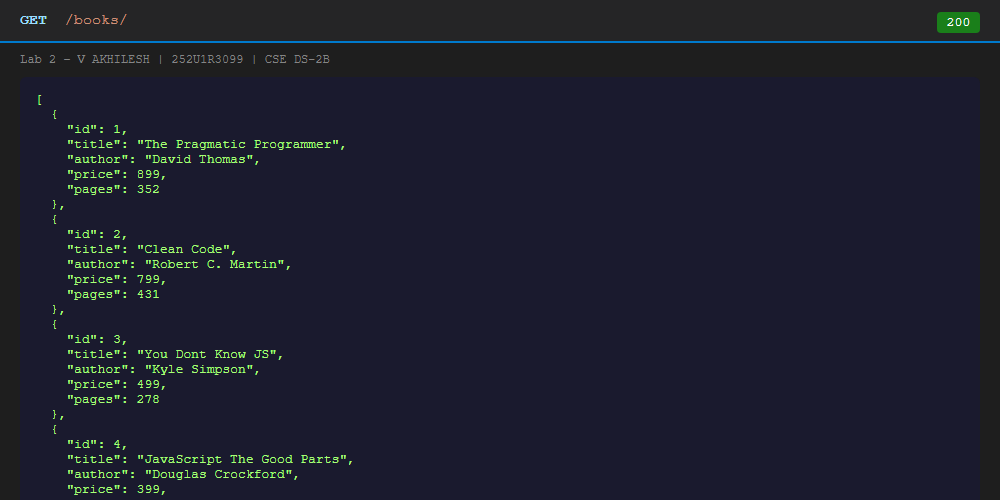
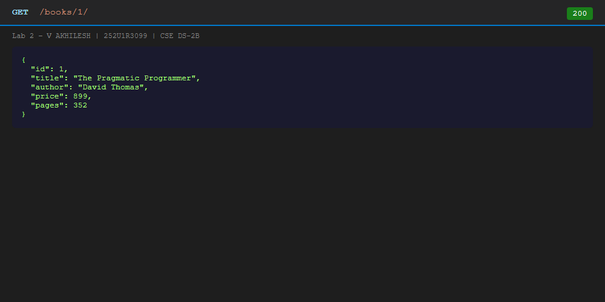
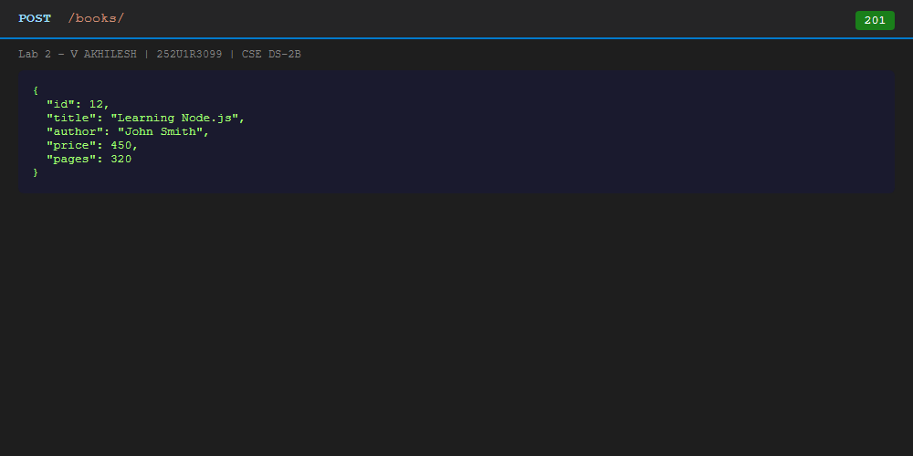
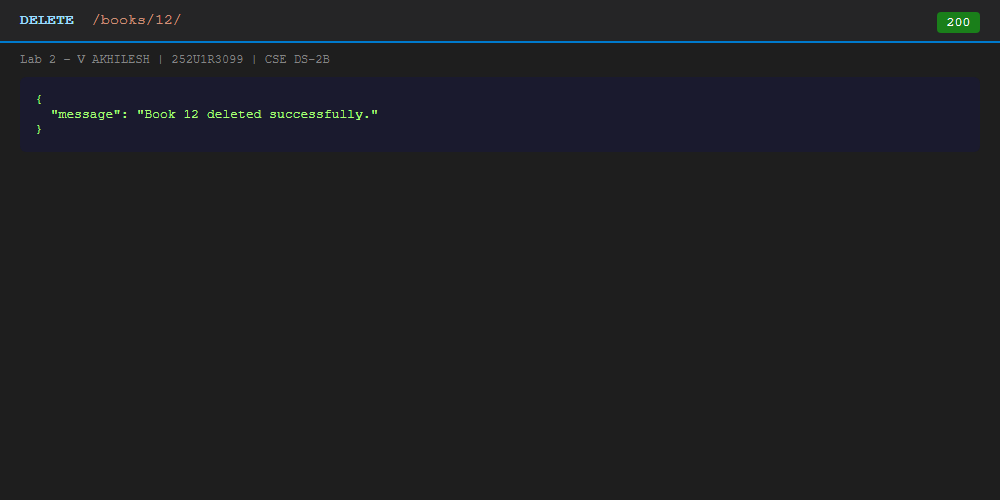
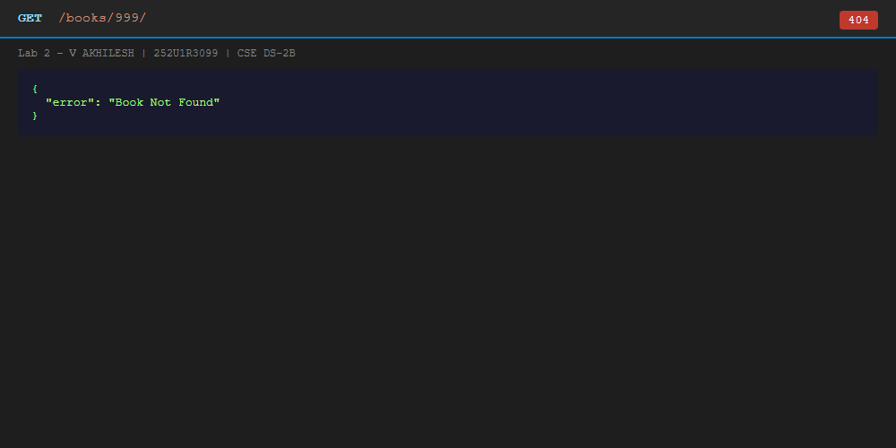
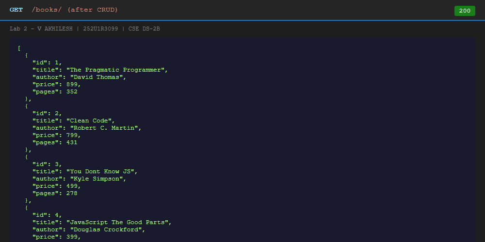
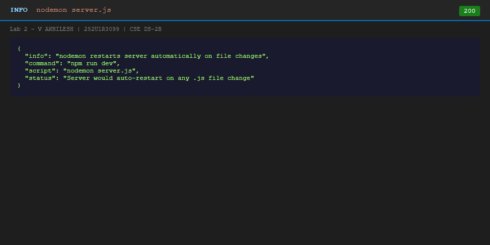

# Lab 2 - SQLite Database and CRUD Routes

> **Deployment URL:** See Deployment section below.

---

## Student Details

| Field            | Details                          |
|------------------|----------------------------------|
| Student Name     | V AKHILESH                       |
| Reg. Number      | 252U1R3099                       |
| Section          | CSE DS-2B                        |
| Course           | Backend Development Fundamentals |
| Lab Number       | Lab 2                            |
| Lab Title        | SQLite Database and CRUD Routes  |

---

## Project Description

This project is Lab 2 of the Backend Development Fundamentals course. It demonstrates how to:

1. Create and connect a SQLite database in Node.js.
2. Build a fully functional REST API with Express.js.
3. Implement all five CRUD operations (Create, Read, Update, Delete).
4. Use parameterised SQL queries to prevent SQL injection.
5. Use async/await for clean asynchronous database code.
6. Use nodemon for automatic server restarts during development.

---

## Objectives

- Understand how to connect a SQLite database to a Node.js server.
- Implement the `initializeDBAndServer()` pattern.
- Build five RESTful API endpoints with correct HTTP status codes.
- Practice safe database queries using `?` placeholders.
- Test APIs and verify actual database changes.

---

## Technologies Used

| Technology | Version  | Purpose                                 |
|------------|----------|-----------------------------------------|
| Node.js    | v24.15.0 | JavaScript runtime                      |
| Express.js | ^4.18.2  | HTTP server and routing framework       |
| SQLite     | ^5.1.1   | Promise-based SQLite wrapper            |
| sqlite3    | ^5.1.7   | SQLite database engine (native driver)  |
| JavaScript | ES2020+  | Programming language                    |
| nodemon    | ^3.0.2   | Auto-restart server on file changes     |

---

## Project Structure

```
lab-02/
|
+-- server.js            <- Express server with all 5 CRUD routes
+-- database.db          <- SQLite database file with book table
+-- db-setup.js          <- Script to create table and insert records
+-- package.json         <- Project config and npm scripts
+-- package-lock.json    <- Locked dependency versions
+-- .gitignore           <- Excludes node_modules, .env
+-- README.md            <- This documentation file
|
+-- screenshots/
    +-- db-initial-records.png   <- Book table with 10 records
    +-- get-all-books.png        <- GET /books/ response
    +-- get-one-book.png         <- GET /books/1/ response
    +-- post-new-book.png        <- POST /books/ 201 response
    +-- put-update-book.png      <- PUT /books/:id/ 200 response
    +-- delete-book.png          <- DELETE /books/:id/ 200 response
    +-- 404-not-found.png        <- GET /books/999/ 404 response
    +-- db-after-crud.png        <- Database state after CRUD ops
    +-- nodemon-running.png      <- nodemon auto-restart info
```

---

## Database Schema

**Database file:** `database.db`

**Table:** `book`

| Column | Type    | Constraint      | Description             |
|--------|---------|-----------------|-------------------------|
| id     | INTEGER | PRIMARY KEY AUTOINCREMENT | Unique identifier |
| title  | TEXT    | NOT NULL        | Book title              |
| author | TEXT    | NOT NULL        | Author name             |
| price  | INTEGER | NOT NULL        | Price in Rupees         |
| pages  | INTEGER | NOT NULL        | Number of pages         |

**SQL to create the table:**
```sql
CREATE TABLE IF NOT EXISTS book (
  id      INTEGER PRIMARY KEY AUTOINCREMENT,
  title   TEXT    NOT NULL,
  author  TEXT    NOT NULL,
  price   INTEGER NOT NULL,
  pages   INTEGER NOT NULL
);
```

**Initial 10 records:**

| id | title                             | author              | price | pages |
|----|-----------------------------------|---------------------|-------|-------|
| 1  | The Pragmatic Programmer          | David Thomas        | 899   | 352   |
| 2  | Clean Code                        | Robert C. Martin    | 799   | 431   |
| 3  | You Dont Know JS                  | Kyle Simpson        | 499   | 278   |
| 4  | JavaScript The Good Parts         | Douglas Crockford   | 399   | 172   |
| 5  | Eloquent JavaScript               | Marijn Haverbeke    | 599   | 472   |
| 6  | Node.js Design Patterns           | Mario Casciaro      | 999   | 660   |
| 7  | Learning SQL                      | Alan Beaulieu       | 649   | 338   |
| 8  | Database Design for Mere Mortals  | Michael Hernandez   | 749   | 516   |
| 9  | Express in Action                 | Evan Hahn           | 549   | 256   |
| 10 | RESTful Web APIs                  | Leonard Richardson  | 699   | 406   |

---

## Installation Instructions

### Prerequisites
- Node.js (v18 or above)
- npm

### Steps

```bash
# 1. Clone or navigate to the lab-02 folder
cd lab-02

# 2. Install all dependencies
npm install

# 3. Set up the database (creates table + inserts 10 records)
node db-setup.js
```

---

## Running the Server

### Production mode
```bash
npm start
# runs: node server.js
```

### Development mode (with nodemon)
```bash
npm run dev
# runs: nodemon server.js
# Server auto-restarts on every file change
```

---

## SQLite CLI Commands

```bash
# Open the database
sqlite3 database.db

# View all records
SELECT * FROM book;

# View table structure
.schema book

# Exit
.exit
```

---

## API Endpoints

| Method | Endpoint          | Description          | Status Code          |
|--------|-------------------|----------------------|----------------------|
| GET    | /books/           | Get all books        | 200 OK               |
| GET    | /books/:bookId/   | Get one book by ID   | 200 OK / 404         |
| POST   | /books/           | Add a new book       | 201 Created          |
| PUT    | /books/:bookId/   | Update a book by ID  | 200 OK / 404         |
| DELETE | /books/:bookId/   | Delete a book by ID  | 200 OK / 404         |

### Sample Request Bodies

**POST /books/**
```json
{
  "title": "Learning Node.js",
  "author": "John Smith",
  "price": 450,
  "pages": 320
}
```

**PUT /books/:bookId/**
```json
{
  "title": "Advanced Node.js",
  "author": "John Smith",
  "price": 550,
  "pages": 400
}
```

---

## Screenshots

### Database - Initial 10 Records


### GET All Books (200 OK)


### GET One Book (200 OK)


### POST New Book (201 Created)


### PUT Update Book (200 OK)


### DELETE Book (200 OK)


### 404 - Book Not Found


### Database After CRUD Operations


### Nodemon Running


---

## Deployment

### Why SQLite Deployment is Challenging

SQLite stores data in a local `.db` file on disk. Most cloud platforms (Render free tier, Railway) use **ephemeral filesystems**, meaning:

- Every new deployment resets the filesystem.
- Data written to SQLite during runtime is lost on restart.
- The database file is not persisted between deployments.

### Workaround for Deployment

The `db-setup.js` script re-creates and seeds the database on startup. The `server.js` uses `initializeDBAndServer()` which opens/creates the DB automatically.

**To deploy on Render:**
1. Push to GitHub.
2. Create a Web Service on render.com.
3. Set Root Directory to `lab-02`.
4. Set Build Command: `npm install && node db-setup.js`
5. Set Start Command: `node server.js`

> Note: Data will reset on each redeploy. For production, use PostgreSQL instead.

---

## Problems Faced and Solutions

| Problem | Solution |
|---------|----------|
| `Cannot find module 'sqlite'` | Ran `npm install sqlite sqlite3` |
| SQLite CLI not available | Used Node.js sqlite3 module via `db-setup.js` script |
| Server starting before DB ready | Used `initializeDBAndServer()` with async/await |
| SQL injection risk | Used `?` placeholders in all queries |
| Port conflict during testing | Used alternate port 3001 for test script |

---

## Viva Questions and Answers

### Q1. Why do we await the database call?

**Answer:**

Database operations (reading/writing to disk) take time. They are asynchronous — meaning they don't finish instantly like a regular calculation.

- `await` tells JavaScript: "Wait here until this database operation is finished before moving to the next line."
- Without `await`, the code would move forward before the data is ready, and we'd get `undefined` or wrong results.
- `await` only works inside an `async` function, which is why all our route handlers use `async (req, res) => {}`.

**Example:**
```js
// WRONG: doesn't wait - books might be undefined
const books = db.all('SELECT * FROM book');

// CORRECT: waits for database to return data
const books = await db.all('SELECT * FROM book');
```

---

### Q2. What is SQL injection and how do placeholders prevent it?

**Answer:**

**SQL Injection** is a hacking technique where an attacker types malicious SQL code into an input field. This can delete your entire database or expose private data.

**Example of unsafe code:**
```js
// DANGEROUS - user controls the query!
const query = `SELECT * FROM book WHERE id = ` + req.params.id;
// If id = "1; DROP TABLE book;" - the whole table gets deleted!
```

**Parameterised queries with `?` placeholders are safe:**
```js
// SAFE - the ? is replaced safely, never executed as SQL
const book = await db.get('SELECT * FROM book WHERE id = ?', [bookId]);
```

The `?` placeholder tells SQLite to treat the user input as **pure data**, never as executable SQL code. This completely prevents SQL injection.

---

### Q3. When is PUT used instead of POST?

**Answer:**

- **POST** is used to **CREATE** a new resource. Every time you call POST, a new record is created. Example: Adding a new book.
- **PUT** is used to **UPDATE** an existing resource. You provide the ID of the resource you want to replace. Example: Updating book with id=1.

| Method | Action    | Example                      |
|--------|-----------|------------------------------|
| POST   | Create    | POST /books/ - adds new book |
| PUT    | Update    | PUT /books/1/ - updates book 1 |

---

## Additional Concepts

### What is SQLite?
SQLite is a lightweight database that stores all data in a single `.db` file on your computer. Unlike MySQL or PostgreSQL, it doesn't need a separate server to run. It's perfect for small applications, prototypes, and learning.

### What is CRUD?
CRUD stands for the four basic database operations:
- **C**reate — Add new data (POST)
- **R**ead — Retrieve data (GET)
- **U**pdate — Modify existing data (PUT)
- **D**elete — Remove data (DELETE)

### What is a Primary Key?
A primary key is a unique identifier for each row in a table. In our `book` table, `id` is the primary key. No two books can have the same `id`. `AUTOINCREMENT` means SQLite automatically assigns the next number (1, 2, 3, ...) when a new book is added.

### What is a Database Connection?
A database connection is the link between your Node.js server and the SQLite file. Without opening this connection, your server cannot read or write any data. In our code, `db = await open({...})` establishes this connection.

### What is async/await?
`async/await` is a modern JavaScript syntax for handling asynchronous operations (tasks that take time, like reading from a database or calling an API). `async` marks a function as asynchronous. `await` pauses execution until the async operation completes.

### What is a Parameterised Query?
A parameterised query uses `?` placeholders instead of directly embedding user input into SQL. The database driver safely replaces `?` with the actual value, preventing SQL injection attacks.

### What is nodemon?
nodemon is a development tool that watches your project files for changes. When you save any `.js` file, nodemon automatically restarts the Node.js server. This saves you from manually stopping and restarting the server during development.

### Difference between GET, POST, PUT and DELETE

| Method | Purpose       | Has Body? | Safe to repeat? |
|--------|--------------|-----------|-----------------|
| GET    | Read data     | No        | Yes             |
| POST   | Create data   | Yes       | No (creates multiple) |
| PUT    | Update data   | Yes       | Yes             |
| DELETE | Delete data   | No        | Yes             |

### What is an API?
API stands for Application Programming Interface. It is a set of rules that allows two software applications to communicate. Our Express server is an API — it accepts HTTP requests and returns JSON responses.

### What is an HTTP Status Code?
An HTTP status code is a 3-digit number that tells the client whether the request succeeded or failed:
- **200** - OK (success)
- **201** - Created (new resource made)
- **400** - Bad Request (invalid input)
- **404** - Not Found (resource doesn't exist)
- **500** - Internal Server Error (server crashed)

---

## Author

**V AKHILESH**
Registration Number: 252U1R3099
Section: CSE DS-2B
Course: Backend Development Fundamentals - Lab 2
